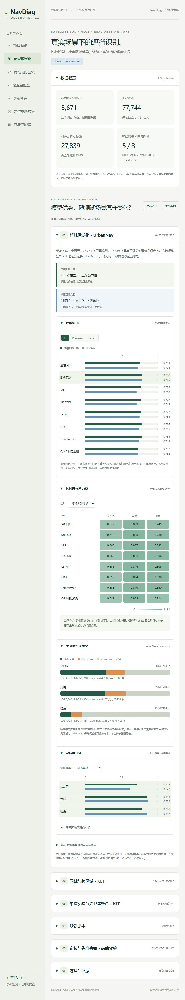
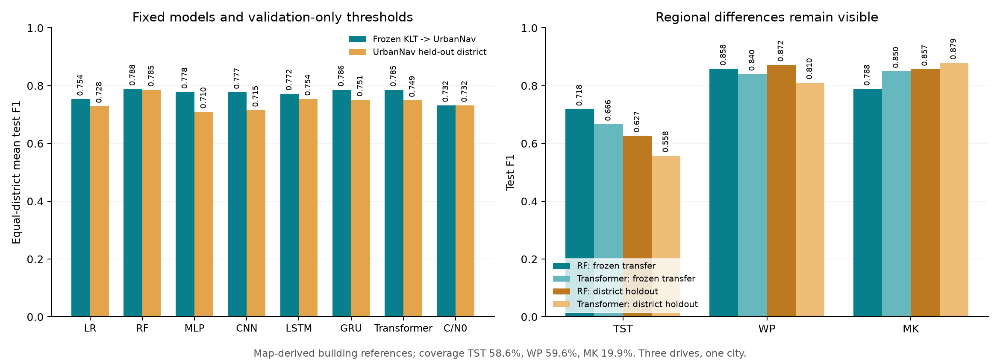
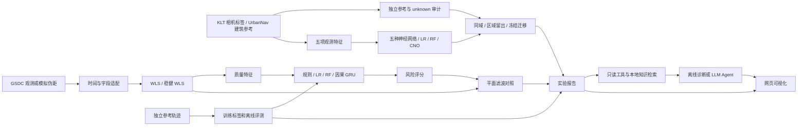

# NavDiag

[](https://github.com/yyyx0402/navdiag/actions/workflows/ci.yml)

**GNSS 遮挡识别、区域实验与证据诊断 / GNSS LOS/NLOS experiments and evidence-backed diagnostics**

把卫星导航专业知识与机器学习、LLM 工具调用结合起来的项目。主线是逐卫星 LOS/NLOS 识别：公开数据预处理、五种神经网络与传统参照、同域和区域留出实验、错误分析与证据诊断。定位和“水平误差 >10 m”告警保留为独立辅助实验。

v0.3 已完成 KLT 九段采集的双协议对比，以及 UrbanNav 三个新城区的冻结源模型迁移与六个城区互斥方向。网页以真实识别实验为主，提供可折叠面板、指标切换条形图、区域热力图、参考标签覆盖率、混淆矩阵与逐卫星检查。无需模型密钥即可查看离线证据。

**结果边界：**修正 GSDC 2021 时间与参考高度处理后，公开数据共 4,572 个匹配历元；两个完整行程用于训练和验证，留出解析样例只有 11 个历元，且没有失准正样本。旧真实验证 F1 0.991 已撤回，见[修正记录](docs/experiments/gsdc2021_correction.md)。模拟指标只验证流程；真实大模型评测需要用户自行配置密钥。



工程检查和研究边界见[项目检查记录](docs/PROJECT_REVIEW.md)。RAG 包含 11 条短笔记、9 份原创文档的 114 段资料、本地 BGE 中文向量与关键词检索、来源行号和实验证据投影。新增相关查询命中 6/8，无关查询返回空结果 5/6；这些是小型手写查询集的检索检查，不代表回答正确率。工具 Agent 可由 LLM 选择工具和改写查询；真实 GLM 问答质量尚未评测，详见 [RAG 实施记录](docs/RAG_RETRIEVAL.md)。

## 本地新增：真实遮挡识别

已新增[UrbanNav 未见城区泛化](docs/experiments/urbannav_generalization.md)：公开记录来自尖沙咀、黄埔、旺角，共 5,671 个原始历元、77,744 条卫星观测。独立位置和三维建筑图产生可评分几何参考 27,839 条，其余为 unknown。冻结 KLT 模型和源阈值的外部测试已完成；另完成同设备、同地图标签方法的一城区训练、另一城区验证、第三城区测试的六个方向，继续使用固定参数，无新增搜索。

RF 的外部/城区互斥平均 F1 为 0.7884/0.7852，Transformer 为 0.7852/0.7489；旺角的 Transformer F1 更高，逐城区结果见报告。静态建筑参考、低质量/边缘样本排除和旺角 19.9% 的标签覆盖率限制了结论。它们全部位于香港，**跨城市验证尚未完成**。对 C/N0 真实分布、固定规则两列成绩相同的原因与同城测试价值的理性分析见[域偏移审计](docs/experiments/nlos_domain_audit.md)。

```powershell
.\.venv\Scripts\python.exe scripts/fetch_urbannav.py
.\.venv\Scripts\python.exe tools/urbannav/prepare.py
# 依赖下文 KLT 双协议实验已经生成的源模型。
.\.venv\Scripts\python.exe -m navdiag evaluate-nlos-regions
.\.venv\Scripts\python.exe -m navdiag serve --artifacts artifacts/navigation_demo --nlos-artifacts artifacts/klt_protocols --generalization-artifacts artifacts/urbannav_generalization
```



当前主实验采用[同域与跨区域的配对设计](docs/experiments/nlos_protocols.md)：同域训练覆盖测试区域的其他采集段，跨区域训练完全排除目标区域；每对使用相同验证和测试采集段，分别考察三个 KLT 区域。固定原始参数，不继续调参；阈值和检查点只由验证集确定。

数据已扩展到九段、三个日期，2,851 个历元、45,228 条卫星观测，并用相同流程重算特征。旧表全部 26,522 条标签及五项特征与重算结果一致（浮点容差 1e-6）；排除了原作者声明不可靠的 KLT3-649 标签。同域训练比例约 59%～65%，按完整段接近 6∶2∶2；跨区域比例随区域大小变化。每次训练使用 1,277～1,857 个历元，原实验为 595 个。

此前[56 组验证集超参数搜索](docs/experiments/nlos_hyperparameter_search.md)保留为历史开发记录；这些获胜参数没有迁移到新主实验。下表也是历史四段默认实验，不是双协议实验的成绩。

历史 v0.2 是工程原型。v0.3 新增独立卫星级 LOS/NLOS 任务，复用 [KLT / Fossett Laboratory 特征表](https://github.com/fossettlab/gnss-nlos-notebook)，与“定位误差 > 10 m”任务分开评估。以下四段实验保留为历史记录。

26,522 条卫星观测来自四个短采集段。KLT2 两段训练（9,830 行），KLT1 验证（6,607），KLT3 测试（10,085）；同一区域不跨集合。标签来自鱼眼相机天空掩膜，模型只读取信号/几何特征。高楼、树木等物体类型未知，LOS 也可能包含多径。

| 方法 | Test Precision | Test Recall | Test F1 |
| --- | ---: | ---: | ---: |
| C/N0 固定规则 | 0.621 | 0.625 | 0.623 |
| LR | 0.796 | 0.658 | 0.720 |
| RF（验证集选中） | 0.672 | 0.778 | 0.721 |
| MLP（历史窗口） | 0.697 | 0.713 | 0.705 |
| 1D CNN | 0.689 | 0.752 | 0.719 |
| LSTM | 0.716 | 0.700 | 0.708 |
| GRU（神经网络组验证优选） | 0.739 | 0.684 | 0.710 |
| Transformer（32 次观测） | 0.782 | 0.653 | 0.712 |

RF 仍有 1,366 次误报、801 次漏报，强信号 NLOS 是主要短板。五种神经网络统一使用同一卫星过去及当前的 32 项五特征观测、训练预算与验证早停，当前只比较完整模型，不保留组件消融。RF 由验证集在全体模型中选出；CNN 测试 F1 与其接近，但不按测试排名重新选模。只有一个留出区域和一个种子，尚未证明跨城市/设备泛化或定位改善。详见[五网络实验](docs/experiments/five_neural_nlos.md)、[历史 Transformer 实验](docs/experiments/transformer_nlos.md)与[标签定义](docs/OBSTRUCTION_LABELS.md)。

用户指定的 Zhang 2023 Transformer-Enhanced LSTM 论文已完成[复现条件核对](docs/research/zhang2023_reproduction.md)和[NLOS 学习解读](docs/lessons/05_nlos_zhang2023.md)。其跨卫星上下文、输入特征和误差回归任务与当前初版不同，尚未完成论文模型或结果复现。

```powershell
.\.venv\Scripts\python.exe scripts/fetch_nlos_data.py
.\.venv\Scripts\python.exe -m pip install -e ".[temporal,gnss]"
.\.venv\Scripts\python.exe scripts/fetch_klt_extended.py
.\.venv\Scripts\python.exe tools/klt/prepare.py
.\.venv\Scripts\python.exe -m navdiag compare-nlos-protocols
.\.venv\Scripts\python.exe -m navdiag serve --artifacts artifacts/navigation_demo --nlos-artifacts artifacts/klt_protocols
```

网页各部分都可以展开与收起，并记住主要面板的状态。泛化和 KLT 对比支持切换 Precision / Recall / F1，点击模型联动区域表现；精确数值表按需展开。模拟定位默认收起，问答任务明确区分卫星 NLOS 与位置失准。常量预测参照、随机种子与 SHA-256 等信息保存在 JSON 报告。上游数据与实现留在 Git 忽略目录；独立预处理工具使用 GPL，详见[工具许可](tools/klt/README.md)。

## 项目结构



参考误差不作为模型输入。滤波器不读取参考轨迹；真实 IMU 原始姿态/标定流程还没有实现，当前支持的是已转换到 ENU 的平面加速度接口。

## 快速运行

推荐 Python 3.12，在项目根目录执行。Windows PowerShell 不需要激活虚拟环境：

```powershell
python -m venv .venv
.\.venv\Scripts\python.exe -m pip install -c requirements-lock.txt -e ".[dev]"
# 可选：CPU 版 PyTorch，用于 GRU / Transformer
.\.venv\Scripts\python.exe -m pip install torch==2.14.1 --index-url https://download.pytorch.org/whl/cpu
.\.venv\Scripts\python.exe -m navdiag demo --navigation --with-gru --out artifacts/navigation_demo
.\.venv\Scripts\python.exe -m navdiag serve --artifacts artifacts/navigation_demo
```

浏览器打开 **http://127.0.0.1:8765**。不安装 PyTorch 时，去掉 `--with-gru`，其余模型和网页照常使用。Linux / macOS 将解释器路径替换为 `.venv/bin/python`。首次安装需要网络，模拟实验及离线诊断在本机运行。

`demo --navigation` 生成 15 个模拟行程，先模拟卫星坐标与伪距，再运行本项目的定位算法。普通 `demo` 是更简单的特征教学样例。

## 公开真实数据版本

下载脚本从 Stanford NavLab 已发布的 GitHub 文件获取 8 个示例文件，不需要 Kaggle 账号。版本、大小和 SHA-256 固定在 [public_sources.json](config/public_sources.json)，不重新分发第三方数据。

```powershell
.\.venv\Scripts\python.exe scripts/fetch_public_data.py
.\.venv\Scripts\python.exe -m navdiag prepare-gsdc --root data/raw --out data/processed/public_gsdc
.\.venv\Scripts\python.exe -m navdiag train --csv data/processed/public_gsdc/epochs.csv --allow-missing-features --with-gru --split-manifest config/public_split.json --out artifacts/public_gsdc
.\.venv\Scripts\python.exe -m navdiag serve --artifacts artifacts/public_gsdc --port 8766
```

公开例子主要用于格式适配、定位和训练流程验证。GSDC 2021 派生文件没有 C/N0，保留缺失值；训练集不足 50% 覆盖的特征被移除，其他缺失值仅用训练集拟合的中位数填充。[数据说明](data/README.md)解释字段、时间换算、参考对齐和来源。

## 诊断与 API

```powershell
.\.venv\Scripts\python.exe -m navdiag ask "比较模型的 F1 和召回率" --provider offline
.\.venv\Scripts\python.exe -m navdiag evaluate-agent --provider offline --out artifacts/agent_eval.json
.\.venv\Scripts\python.exe -m navdiag ask "比较模型的 F1" --task-context satellite_nlos --nlos-artifacts artifacts/klt_protocols --provider offline
.\.venv\Scripts\python.exe scripts/review_project.py
```

离线模式是确定性工具基线。网页 **诊断助手 → 自定义模型 API → 配置模型与 API** 支持自行填写服务地址、模型 ID 和本地密钥，并保存多个连接。默认“证据问答”先读取实验与笔记，再交给模型解释；支持 function calling 的模型也可选择工具 Agent。接口采用 Chat Completions 兼容格式，不绑定供应商或模型。步骤与本地 Ollama 接入见[自选模型与 API](docs/LLM_API.md)。CLI 也可复用保存的连接或 [.env.example](.env.example)；实际密钥不提交到 Git。

工具包括行程列表、观测汇总、片段风险、模型对照、离线定位指标与本地技术检索。回答记录 `[E1]` 等证据 ID、工具结果、耗时和 API usage。在线观测汇总不读取参考标签，离线误差对照明确使用参考轨迹。实现与评测边界见 [Agent 说明](docs/AGENT.md)。

## 已运行的结果

以下是 **15 行程、1,800 历元的模拟伪距实验**；测试为 3 行程、360 历元。验证集选出 LR。

| 方法 | 测试 Precision | Recall | F1 |
| --- | ---: | ---: | ---: |
| 固定规则 | 0.420 | 0.241 | 0.307 |
| LR | 0.509 | 0.966 | 0.667 |
| RF | 0.503 | 0.920 | 0.650 |
| GRU | 0.491 | 0.943 | 0.646 |

| 定位方法 | Median (m) | P95 (m) | RMSE (m) |
| --- | ---: | ---: | ---: |
| WLS | 4.867 | 19.913 | 9.043 |
| 固定方差滤波 | 2.598 | 9.868 | 4.691 |
| 自适应方差滤波 | 3.127 | 10.774 | 5.559 |

自适应方案在这个实验中没有超过固定方案，保留这个结果用于学习和后续研究。完整真实/模拟记录和原始报告摘要见 [v0.2 实验记录](docs/experiments/v0_2.md)。不能把这些数值写成真实城市定位提升。

## 实验产物与验证

每次训练输出 `report.json`、`predictions.csv`、`risk_plot.png` 和 `models.joblib`。报告保存数据指纹、行程划分、特征、缺失覆盖、阈值和指标。模型仅加载可信来源；`predict` 可以对不包含参考误差的观测表推理。

```powershell
.\.venv\Scripts\python.exe -m pytest -q
.\.venv\Scripts\python.exe -m navdiag predict --csv your_observations.csv --model artifacts/navigation_demo/models.joblib --out artifacts/inference.csv
```

本地测试覆盖坐标/定位、时间修正、划分泄漏、卫星历史窗口、Transformer 因果注意力、测试标签隔离、滤波、模型持久化、API 协议、文档检索和网页接口。39 个诊断问题的离线工具/引用/检索检查通过；这不代表真实 LLM 的语义正确率。远程 CI 仅覆盖已上传版本，当前修改以本地验证为准。

## 后续学习

先使用成品，再按 [学习路线](docs/LEARNING_PATH.md)逐段读代码。配套资料包括 [特征与标签](docs/lessons/01_features_labels_splits.md)、[定位与参考对齐](docs/lessons/02_positioning.md)、[模型与因果推理](docs/lessons/03_models.md)、[Agent 工具调用](docs/lessons/04_agent.md)、[模型卡](docs/MODEL_CARD.md)和 [扩展路线](docs/ROADMAP.md)。

原创代码使用 [MIT License](LICENSE)。第三方数据和文档适用各自条款，原始数据、密钥、环境、缓存及生成产物由 `.gitignore` 排除。贡献与发布流程见 [CONTRIBUTING](CONTRIBUTING.md) 和 [PUBLISHING](docs/PUBLISHING.md)。
