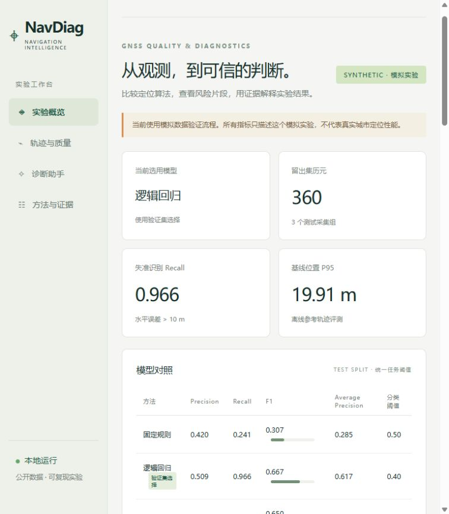
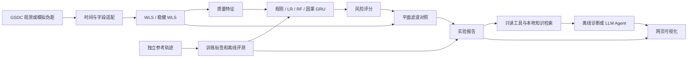

# NavDiag

**GNSS 定位质量预测与证据诊断 / GNSS quality prediction and evidence-backed diagnostics**

把卫星导航专业知识与机器学习、LLM 工具调用结合起来的开源项目。输入 GNSS 观测，计算基线定位和质量特征，预测当前水平误差是否超过 10 米，再通过实验工具与技术笔记解释结果。

v0.2 已实现公开 GSDC 数据处理、WLS / 稳健 WLS、规则 / LR / RF / 因果 GRU、平面 Kalman 滤波、诊断工具、GPT / DeepSeek API 适配和本地网页。无需账号或模型密钥即可运行模拟演示与公开数据流程。

**结果边界：**公开数据共 4,575 个匹配历元，但两个完整行程用于训练和验证，留出解析样例只有 11 个历元，且没有失准正样本；真实测试 Recall / F1 无法评估。模拟指标只验证流程。API 协议已做模拟响应测试，真实大模型评测需要用户自行配置密钥。



## 项目结构



参考误差不作为模型输入。滤波器不读取参考轨迹；真实 IMU 原始姿态/标定流程还没有实现，当前支持的是已转换到 ENU 的平面加速度接口。

## 快速运行

推荐 Python 3.12，在项目根目录执行。Windows PowerShell 不需要激活虚拟环境：

```powershell
python -m venv .venv
.\.venv\Scripts\python.exe -m pip install -c requirements-lock.txt -e ".[dev]"
# 可选：CPU 版 PyTorch，用于 GRU
.\.venv\Scripts\python.exe -m pip install torch==2.14.1 --index-url https://download.pytorch.org/whl/cpu
.\.venv\Scripts\python.exe -m navdiag demo --navigation --with-gru --out artifacts/navigation_demo
.\.venv\Scripts\python.exe -m navdiag serve --artifacts artifacts/navigation_demo
```

浏览器打开 **http://127.0.0.1:8765**。不安装 PyTorch 时，去掉 `--with-gru`，其余模型和网页照常使用。Linux / macOS 将解释器路径替换为 `.venv/bin/python`。首次安装需要网络，模拟实验及离线诊断在本机运行。

`demo --navigation` 生成 15 个模拟行程，先模拟卫星坐标与伪距，再运行本项目的定位算法。普通 `demo` 是更简单的特征教学样例。

## 公开真实数据版本

下载脚本从 Stanford NavLab 已发布的 GitHub 文件获取 8 个示例文件，不需要 Kaggle 账号。版本、大小和 SHA-256 固定在 [public_sources.json](config/public_sources.json)，不重新分发第三方数据。

```powershell
.\.venv\Scripts\python.exe scripts/fetch_public_data.py
.\.venv\Scripts\python.exe -m navdiag prepare-gsdc --root data/raw --out data/processed/public_gsdc
.\.venv\Scripts\python.exe -m navdiag train --csv data/processed/public_gsdc/epochs.csv --allow-missing-features --with-gru --split-manifest config/public_split.json --out artifacts/public_gsdc
.\.venv\Scripts\python.exe -m navdiag serve --artifacts artifacts/public_gsdc --port 8766
```

公开例子主要用于格式适配、定位和训练流程验证。GSDC 2021 派生文件没有 C/N0，保留缺失值；训练集不足 50% 覆盖的特征被移除，其他缺失值仅用训练集拟合的中位数填充。[数据说明](data/README.md)解释字段、时间换算、参考对齐和来源。

## 诊断与 API

```powershell
.\.venv\Scripts\python.exe -m navdiag ask "比较模型的 F1 和召回率" --provider offline
.\.venv\Scripts\python.exe -m navdiag evaluate-agent --provider offline --out artifacts/agent_eval.json
```

离线模式是确定性工具基线。API 模式才由大模型决定工具调用与组织回答：先将 [.env.example](.env.example) 复制为 `.env`，在本地设置 `NAVDIAG_PROVIDER` 和密钥，再选择 `--provider openai` 或 `deepseek`。默认分别使用 `gpt-6-luna` / `deepseek-flash`，也可配置其他支持工具调用的兼容接口。不要把密钥发到聊天或提交到 Git。

工具包括行程列表、观测汇总、片段风险、模型对照、离线定位指标与本地技术检索。回答记录 `[E1]` 等证据 ID、工具结果、耗时和 API usage。在线观测汇总不读取参考标签，离线误差对照明确使用参考轨迹。实现与评测边界见 [Agent 说明](docs/AGENT.md)。

## 已运行的结果

以下是 **15 行程、1,800 历元的模拟伪距实验**；测试为 3 行程、360 历元。验证集选出 LR。

| 方法 | 测试 Precision | Recall | F1 |
| --- | ---: | ---: | ---: |
| 固定规则 | 0.420 | 0.241 | 0.307 |
| LR | 0.509 | 0.966 | 0.667 |
| RF | 0.503 | 0.920 | 0.650 |
| GRU | 0.491 | 0.943 | 0.646 |

| 定位方法 | Median (m) | P95 (m) | RMSE (m) |
| --- | ---: | ---: | ---: |
| WLS | 4.867 | 19.913 | 9.043 |
| 固定方差滤波 | 2.598 | 9.868 | 4.691 |
| 自适应方差滤波 | 3.127 | 10.774 | 5.559 |

自适应方案在这个实验中没有超过固定方案，保留这个结果用于学习和后续研究。完整真实/模拟记录和原始报告摘要见 [v0.2 实验记录](docs/experiments/v0_2.md)。不能把这些数值写成真实城市定位提升。

## 实验产物与验证

每次训练输出 `report.json`、`predictions.csv`、`risk_plot.png` 和 `models.joblib`。报告保存数据指纹、行程划分、特征、缺失覆盖、阈值和指标。模型仅加载可信来源；`predict` 可以对不包含参考误差的观测表推理。

```powershell
.\.venv\Scripts\python.exe -m pytest -q
.\.venv\Scripts\python.exe -m navdiag predict --csv your_observations.csv --model artifacts/navigation_demo/models.joblib --out artifacts/inference.csv
```

本机通过 31 个测试，覆盖坐标/定位、时间对齐、划分泄漏、因果窗口、滤波、模型持久化、API 协议和网页接口。30 个诊断问题的离线工具/引用/检索检查通过；这不代表真实 LLM 的语义正确率。GitHub Actions 配置包含 CPU GRU 与包构建，远程 CI 状态以实际运行结果为准。

## 后续学习

先使用成品，再按 [学习路线](docs/LEARNING_PATH.md)逐段读代码。配套资料包括 [特征与标签](docs/lessons/01_features_labels_splits.md)、[定位与参考对齐](docs/lessons/02_positioning.md)、[模型与因果推理](docs/lessons/03_models.md)、[Agent 工具调用](docs/lessons/04_agent.md)、[模型卡](docs/MODEL_CARD.md)和 [扩展路线](docs/ROADMAP.md)。

原创代码使用 [MIT License](LICENSE)。第三方数据和文档适用各自条款，原始数据、密钥、环境、缓存及生成产物由 `.gitignore` 排除。贡献与发布流程见 [CONTRIBUTING](CONTRIBUTING.md) 和 [PUBLISHING](docs/PUBLISHING.md)。
