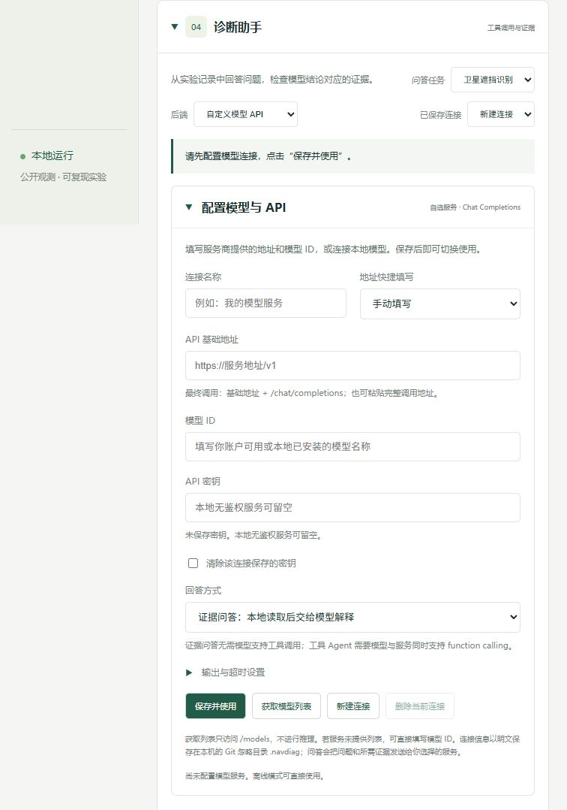

# 自选模型与 API

网页不绑定某家供应商或某个模型。进入 **诊断助手 → 后端 → 自定义模型 API**，展开“配置模型与 API”，填写连接名称、API 基础地址、模型 ID 和密钥，然后点击 **保存并使用**。可以保存多个连接，随时在“已保存连接”里切换。保存配置不会调用模型；点击“分析实验”才发送问答。



## 地址与模型

本接口使用 **Chat Completions 兼容格式**，向 `基础地址 + /chat/completions` 发送请求。兼容格式可以由不同供应商及本地服务实现；模型名称没有 GPT 默认值。供应商自有且不兼容此格式的接口需要单独编写适配器。

| 服务               | API 基础地址                                      | 模型 ID                |
| ------------------ | ------------------------------------------------- | ---------------------- |
| 你选择的远程供应商 | 供应商给出的 HTTPS 地址，通常包含 `/v1`           | 该账户实际可用的 ID    |
| Ollama 本地        | `http://127.0.0.1:11434/v1`                       | 本地已安装的模型名     |
| vLLM 本地          | 部署时设置的地址，例如 `http://127.0.0.1:8000/v1` | 部署时对外发布的模型名 |

也可粘贴完整的 `/chat/completions` 地址，保存时会转换为基础地址。网页的“地址快捷填写”只填写本地服务地址，不安装或下载模型。Ollama 的本地接口可以不提供密钥；若你的服务启用了鉴权，则填写该服务的 key。[Ollama 官方兼容接口文档](https://docs.ollama.com/api/openai-compatibility)说明了本地地址、聊天和模型列表接口。

**获取模型列表**只请求 `GET 基础地址/models`，不生成回答。输入框会提供返回的 ID；部分服务不支持模型列表，可以直接手动填写。获取列表成功不能证明模型可推理、额度足够或支持工具调用。

## 两种回答方式

- **证据问答**：先读取相关实验记录，检索技术笔记与文档段落，再将投影后的结构化依据交给模型解释。只进行一次聊天请求，不要求模型支持 function calling，保留 `[E#]` 来源记录。
- **工具 Agent**：模型选择允许的只读工具，服务器执行并把结果送回模型，直到得到最终回答。要求模型和接口支持 tools、tool choice 与 tool-result 消息。最多五轮、每轮六个工具调用；没有调用证据工具的回答会提示失败，可切换到证据问答。

当前已实现本地BGE与关键词混合检索，并完成GLM-5.3的17次小型真实证据问答检查，保留失败和复测；独立问题集、工具Agent生成质量与稳定性仍需进一步验证，见[真实回答记录](experiments/glm_quality.md)和[RAG](RAG_RETRIEVAL.md)。完全缺少依据时证据问答本地提示且不调用API；工具Agent保留LLM改写查询和选择工具的能力。引用ID校验不保证事实正确。

“输出与超时设置”支持输出上限 128–32,768 tokens、单次请求超时 5–300 秒，以及可选推理强度。默认不额外发送推理参数；只选择供应商支持的值。新连接默认 4,096 tokens，已有连接的设置保留。

GLM-5.3推理设置依据[官方说明](https://docs.z.ai/guides/llm/glm-5.3)。本项目已在内存临时使用 `low`、8192 tokens、120秒完成17次真实证据问答，未改动用户保存的连接。因此该记录验证临时调用设置，不能冒充原网页配置的完整等价验证；质量问题与耗时见[记录](experiments/glm_quality.md)。使用其他模型时只选择实际支持的参数。

空回答会区分输出预算耗尽、只有思考内容、内容过滤或普通空结果。`finish_reason=length` 且已有正文时仍显示正文，同时明确标记不完整。思考内容不作为最终回答，错误不会自动触发额外付费重试。

## 本地保存与切换

默认在项目的 `.navdiag/llm_connections.json` 保存连接。指定 `--env-file` 时，连接目录位于该文件的同级位置。密钥以**明文**保存在本机，读取接口只返回“是否已保存密钥”，不返回密钥本身；不写入浏览器 localStorage。`.navdiag/` 已加入 Git 忽略和发布检查，实际密钥不要提交或粘贴到聊天中。

修改已保存连接时，密钥留空表示保留；勾选“清除”移除密钥。更换地址必须重新填写对应服务的 key，或明确清除旧 key；不会把旧服务的密钥自动带到新地址。模型请求不跟随 HTTP 重定向。页面上的 API 设置修改后需点击“保存并使用”，未保存的修改会暂停分析按钮。

远程接口使用 HTTPS，本地回环地址允许 HTTP。问题及相应实验证据发送给你选择的地址，不发送原始数据文件、任意本地文件或密钥配置文件。付费远程服务按其规则计费；本地模型仍需自己运行服务并具备所需硬件。

## 命令行复用

网页保存的连接也能用于 `ask` 和 `evaluate-agent`。先查看不含密钥的连接 ID：

```powershell
.\.venv\Scripts\python.exe -c "from navdiag.llm_connections import ConnectionStore, connection_path; print(ConnectionStore(connection_path()).list())"
.\.venv\Scripts\python.exe -m navdiag ask "新城区泛化中哪些模型更占优势？" --connection 你的连接ID --task-context satellite_nlos
```

`--connection` 与 `--provider` 二选一。也可使用 `.env.example` 的 `compatible` 配置；`NAVDIAG_ANSWER_MODE=evidence` 选择证据问答，`tools` 选择工具 Agent。网页“本地 .env 兼容配置”沿用该方式。

接口开发阶段使用本机模拟服务，覆盖模型列表、连接保存/切换、无密钥本地服务、证据传递、工具调用、错误处理和密钥隔离。2026-10-11 的千问连接排查修正了本机地址，并成功读取真实模型列表；真实模型问答仍未执行，尚无实际模型质量评测。

## 连接问题排查

报错区分域名解析、TLS/证书、拒绝连接、传输中断、超时及 HTTP 状态；连接失败不一定是达到超时时限。报错不会回显供应商原始错误文本或密钥。模型列表与鉴权成功只验证列表请求，不能替代问答验证。

千问 Qwen3.8-Flash 的官方基础地址为 `https://maas.qianwenaiapi.com/compatible-mode/v1`，注意域名中的 `api`。[千问官方接入说明](https://platform.qianwenai.com/docs/developer-guides/getting-started/latest-model)。本机曾误填 `maas.qianwenai.com`，出现解析/握手失败；修正后模型列表返回成功并包含 `qwen3.8-flash`。更改已保存连接需刷新页面核对，再进行下一次请求。
