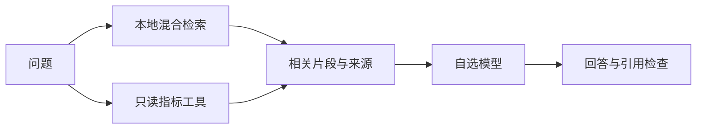

# RAG 与文献推荐

问答结合本地技术资料和当前实测报告。项目指标优先通过只读工具读取，文献摘要用于解释方法；作者成绩与 NavDiag 成绩分别标明。当前没有联网搜索工具。

## 资料与检索

资料包括11条短笔记、10份允许公开的项目文档和20篇原创文献摘要。每个文档片段最多480字符，保留来源、章节与准确行号；构建脚本只读取明确清单，排除本地私有材料、密钥、原始数据和全文 PDF。

本地编码器为 [BAAI/bge-small-zh-v1.5](https://huggingface.co/BAAI/bge-small-zh-v1.5)，revision `7999e1d3359715c523056ef9478215996d62a620`，CLS/L2 归一化、512 tokens 上限。权重与向量缓存不随仓库分发；运行时不下载模型，不调用远程嵌入。

排序为0.55×语义余弦 +0.45×关键词分数，结合 BM25、字符 TF-IDF、术语扩展和有限拼写纠错。语义门槛0.46；技术词保留独立关键词通道。默认最多五段、每份文档最多两段，并去重。排序分数不是相关概率，参数来自小型开发集。



`auto/hybrid` 尝试本地编码器，缺少权重或依赖时明确回退 `sparse`；`sparse` 不加载编码器。上下文省略完整阈值扫描、训练曲线与重复指标，保留相关模型原始分数、覆盖与限制。引用ID存在不代表引用支持结论，仍需检查数值与因果表述。

## 问答与文献推荐

证据问答先准备本地依据，没有相关文档或指标时返回 `generation_skipped=true`，不调用模型。工具 Agent 可让模型改写检索词和选择七个只读工具：`list_trips`、`trip_summary`、`compare_models`、`compare_nlos`、`compare_positioning`、`segment_summary`、`search_knowledge`；最多五轮。

文献入口复用检索器，主题/难度先过滤，最多推荐五篇；空问题浏览全库。阅读卡、全文链接与学习提示只用于界面，不全量发送到 LLM。`POST /api/literature/search` 无模型调用，资料范围见[文献目录](research/reading_list.md)。

## 更新与检查

```powershell
.\.venv\Scripts\python.exe scripts/build_knowledge_corpus.py
.\.venv\Scripts\python.exe scripts/prepare_semantic_index.py --download
.\.venv\Scripts\python.exe scripts/evaluate_retrieval_v2.py --output artifacts/rag_check.json
.\.venv\Scripts\python.exe scripts/evaluate_reading.py --out artifacts/reading_check.json
.\.venv\Scripts\python.exe -m navdiag evaluate-agent --provider offline --out artifacts/agent_check.json
```

修改知识文档后重建语料并重启服务。当前回归摘要与失败案例见[检索报告](experiments/rag_eval_report.json)、[文献查找报告](experiments/reading_retrieval_report.json)。这些手写问题已用于开发，不是独立盲测；命中来源、离线路由通过和模型回答正确是不同指标。[真实回答检查](experiments/glm_quality.md)单独报告生成质量。
