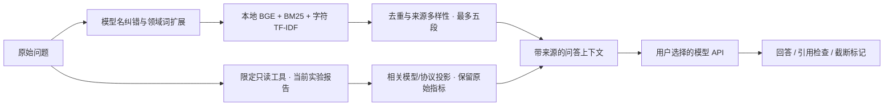
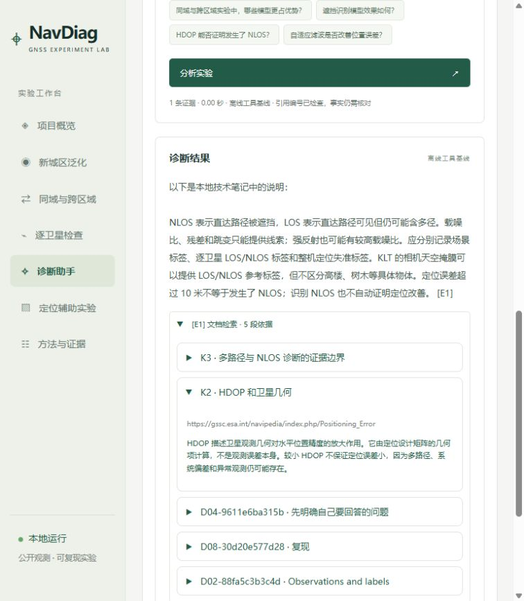

# 检索增强问答：本地语义与关键词检索

先验证“取到了什么依据”，再评估 GLM 如何解释依据。当前版本加入本地 BGE 中文语义向量，与 BM25、字符 TF-IDF 共同排序；没有远程嵌入调用。交叉编码器重排、逐句事实校验和真实 GLM 回答质量评测尚未完成。

后续补充七篇直接相关论文的原创研究摘要，见 [文献阅读清单](research/reading_list.md)。其中包含 GNSS 相关器、RINEX/残差、多频预归一化和表格模型比较。论文条目单独保留作者、年份、DOI、版本链接、核对范围与限制，当前共 132 条资料。当前问答没有联网搜索工具，不能声称模型自行查到了最新论文；七篇摘要也不是全文或系统综述。

七个文献检索检查分别指定对应论文，两种检索模式均命中 7/7，MRR@5 均为 0.9286；它们只验证新增论文可以被检索，不是独立泛化评测。原 52 问题的失败依然保留，详见 [加入文献后的检索报告](experiments/rag_literature_retrieval_report.json)。同语料纯字符检索在这七题的 MRR 为 1.0，因此仍不能把混合排序称为全面最优。

## 资料与处理

知识库包含 11 条短笔记，以及 9 份项目原创文档的 114 个段落：标签说明、模型说明、Zhang 2023 学习解读及复现核对、泛化课程、开源参考、区域分布审计和两类实验说明。每段最多 480 字符，保留文档 ID、段落 ID、章节、来源路径和准确起止行号；长行切分后仍指向原始行。练习及运行命令不纳入回答资料。本机实际 tokenizer 检查包括七篇文献在内的 132 条资料，最大输入长度为 403 tokens，没有被 512-token 编码上限截断。

构建脚本仅读取明确列出的文件，不遍历任意目录，不读取密钥、原始观测或用户 PDF。论文解读是项目原创说明，不把用户提供的整篇论文复制到待开源仓库。更改这九份文档后需重建语料并重新启动网页服务。



`Transformeru` 等相近拼写只用于检索纠错；模型仍收到用户的原始问题。领域词扩展处理有限同义表述，规则可以检查；语义向量补充没有相同关键词的表述。两者都不能代替 LLM 对问题和证据的解释。

采用 [BAAI/bge-small-zh-v1.5](https://huggingface.co/BAAI/bge-small-zh-v1.5)，固定 revision `7999e1d3359715c523056ef9478215996d62a620`。按模型说明使用 CLS 向量与 L2 归一化，只为查询添加中文检索指令；CPU 本地运行，禁止远程代码和运行时模型下载。权重、向量缓存和 SHA-256 manifest 留在 Git 忽略目录。缓存键覆盖资料内容与权重身份，损坏缓存会重建。

最终排序为 0.55 × 语义余弦 + 0.45 × 关键词排序分数，语义候选门槛为 0.46。明确 GNSS 术语还保留独立关键词通道，避免中文模型漏掉 C/N0、GRU 或英文缩写；不把 BM25 除以最大值后的 1.0 当作置信度。门槛来自小型开发集，不代表通用最佳值，余弦和排序分数均不是概率。每份文档最多两段，并去除高度重复段落。

`auto` / `hybrid` 尝试已准备的本地编码器；缺少权重、可选依赖或编码器无法加载时，明确标记回退到 `sparse`。`sparse` 不初始化编码器。网页证据卡显示实际检索方法、来源、排序分数与回退状态。

实验数值通过 `compare_nlos` 等工具读取当前产物；历史文档用于解释方法。发送前省略完整阈值扫描、完整训练曲线及重复逐段指标，保留相关模型的原始分数、分区域成绩、标签覆盖率与实验限制。涉及 RF/Transformer 时提供按协议和区域的 Precision/Recall/F1 差值，帮助模型先核实提问前提；该差值不提供因果解释。

## 第一轮检索评测

以下为第一版的历史结果，原语料为 67 段。旧 23 个查询目前全部视为回归测试，原先的“预留”已经看过，不能再作为独立保留集。

固定 23 个手写查询：12 个开发查询，8 个预留相关查询和 3 个预留无关查询。评测检查前五条是否包含预先指定的来源/章节；不是最终回答正确率，也不评判所有返回段落的相关性。

| 方法                                  | 开发 Hit@5 | 预留 Hit@5 | 预留 MRR@5 | 无关查询返回空结果 |
| ------------------------------------- | ---------: | ---------: | ---------: | -----------------: |
| 原 11 条笔记，字符 TF-IDF             |      58.3% |      75.0% |     0.7500 |                1/3 |
| 扩展语料，字符 TF-IDF                 |      91.7% |      87.5% |     0.8125 |                1/3 |
| 扩展语料，BM25 + 字符 TF-IDF + 词扩展 |     100.0% |      87.5% |     0.7917 |                2/3 |

主要收益来自资料覆盖；混合检索在预留查询的排序上没有超过同语料 TF-IDF，不能宣称它全面更强。R20（用香港结果推断另一城市）没有命中指定来源，R23（客厅沙发颜色）错误返回了项目段落。失败案例保留在报告，不通过修改预留问题或标签抬高成绩。查询集很小、人工设计，后续需要新增真实用户问题作为新的保留集。

完整记录保存在 [检索报告](experiments/rag_retrieval_report.json)。既有 39 个离线问题的工具路由、引用和知识条目检查通过；这些仍不证明 GLM 的解释正确。

## 复现与下一步

第二轮增加 29 个手写查询：9 个相关开发问题、6 个无关开发问题，以及初次评测前保留的 8 个相关问题、6 个无关问题。首轮候选报告保留在 [候选记录](experiments/rag_retrieval_v2_candidate_report.json)。随后依据既有 39 问题的回归失败补回技术缩写的关键词通道；最终报告的所有查询均作为已见回归集，不能冒称新的盲测。

| 方法                   | 新相关查询命中 |  MRR@5 | 新无关查询返回空结果 |
| ---------------------- | -------------: | -----: | -------------------: |
| 同语料字符 TF-IDF      |            5/8 | 0.4479 |                  0/6 |
| 关键词混合与相关性门槛 |            5/8 | 0.6250 |                  5/6 |
| 本地语义与关键词混合   |            6/8 | 0.7500 |                  5/6 |

旧 20 个相关查询命中 19/20，3 个无关查询均返回空结果。新查询仍有 H03（误删正常观测的代价）、H06（随机初始化稳定性）漏检，H13（英文种植番茄）错误返回资料；旧 R13 也未命中指定依据。失败完整保存在 [第二轮报告](experiments/rag_retrieval_v2_report.json)，没有因失败删问题或修改预期来源。小型自编集只说明本轮工程改动，不能推出普遍优势，更不能当作最终回答正确率。

证据问答先执行本地检索和报告工具：没有相关段落且没有相关实验工具结果时，返回“没有找到依据”，标记 `generation_skipped=true`、`backend=local_evidence_guard`，不调用 API。未命中也可能是检索失败，用户可补充术语或切换工具 Agent。工具 Agent 直接让 LLM 选择证据工具、改写查询；不受本地规则预检阻断，仍受轮数预算限制。概念问题不附带不相关的行程指标。没有模型调用的结果不会显示成 GLM 回答。

```powershell
.\.venv\Scripts\python.exe scripts/build_knowledge_corpus.py
.\.venv\Scripts\python.exe -m pip install -c requirements-lock.txt -e ".[rag]"
# 下载公开固定版本权重；不是模型 API 调用。
.\.venv\Scripts\python.exe scripts/prepare_semantic_index.py --download
$env:NAVDIAG_RETRIEVAL_MODE='auto'
.\.venv\Scripts\python.exe scripts/evaluate_retrieval_v2.py
.\.venv\Scripts\python.exe -m navdiag evaluate-agent --provider offline --out artifacts/agent_eval_rag_offline.json
```

网页的“文档检索”证据可展开查看命中章节、原文段落和来源行号。API 的 `context_stats` 描述压缩前后字符数；不是 token 估算或费用承诺。引用编号校验只检查引用存在，不能替代数字一致性和因果解释的人工核对。



不安装 `rag` 可选依赖也能用关键词版。可在启动服务前设置 `$env:NAVDIAG_RETRIEVAL_MODE='sparse'`；自定义模型目录用 `NAVDIAG_EMBEDDING_MODEL_DIR` 环境变量。服务应从项目根目录启动，默认权重目录为 `.cache/models/bge-small-zh-v1.5`。这些变量设置在进程环境，连接配置与 `.env` 的 LLM 设置不会改变它们。

下一轮需要收集真实用户问题、独立的新评测集，并核对 GLM 对数字、前提和引用的解释；还可以比较重排器。实际 GLM 调用当前尚未完成：早先自动审批拦截了外发实验摘要的验证请求，Coding Plan 的自建应用使用范围也需处理。没有把模拟响应写成真实模型成绩。
