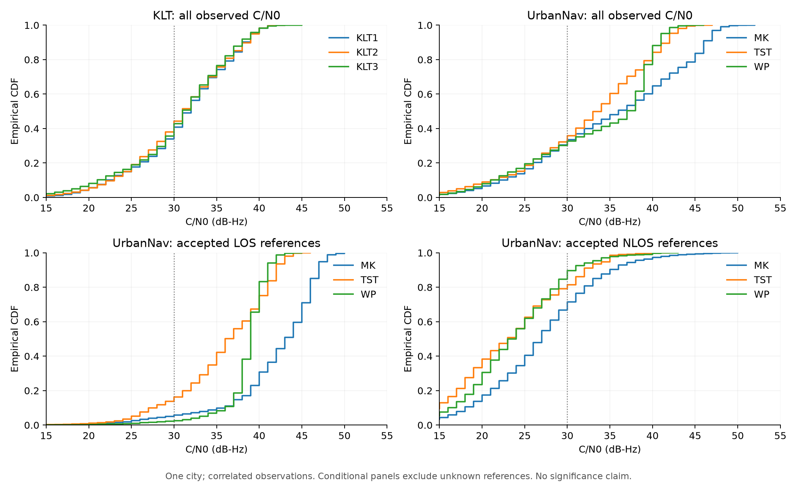

# 同城区域留出是否构成有用的泛化测试？

判断：同城未见区域留出是有效但范围有限的实验；旧 KLT 数据对强 C/N0 域偏移的检验偏弱，不能据此推出跨城市可用。新 UrbanNav 三城区体现更明显的经验信号分布差异，仍全部在香港，尚未完成跨城市独立检验。

## 固定规则成绩相同的原因

KLT 同域/跨区域配对使用完全相同的测试采集段。`C/N0 < 30 dB-Hz` 规则没有训练参数，因此即使训练集合改变，测试预测、标签、混淆矩阵和成绩都不会改变。这是确定性的协议结果，不是区域之间信号分布相同的证据。UrbanNav 外部/城区互斥两列的规则也因使用相同三个目标采集段而一样。

比较区域分布应检查不同区域的观测，而不是这个不经过训练的模型在共享测试段上的两列差值。固定规则仍适合作为物理直觉基线：在新 UrbanNav 不同目标区，其 F1 分别是 TST 0.6468、WP 0.8353、MK 0.7135，确实不相同。

## 对实际数据的检查

[审计脚本](../../scripts/audit_nlos_domains.py)只分析记录，不重新训练、调参或修改参考标签。[结果 JSON](nlos_domain_audit.json)列出分位数、低于 30 的比例、经验 KS 距离和 Wasserstein 距离。C/N0≤0 缺测哨兵不进入分布。表中条件分布仅采用有参考标签且 C/N0 有效的样本；中位数单位 dB-Hz。

| 区域 | 全部有效 C/N0 中位数 | 参考 LOS 中位数 | 参考 NLOS 中位数 |
|---|---:|---:|---:|
| KLT1 | 32 | 33 | 27 |
| KLT2 | 31 | 33 | 27 |
| KLT3 | 31 | 33 | 27 |
| TST | 34 | 36 | 23 |
| WP | 37 | 39 | 24 |
| MK | 36 | 43 | 27 |

KLT 三处全体分布的两两经验 KS 距离为 0.029～0.042，Wasserstein 距离约 0.35～0.49 dB-Hz，曲线接近。相同中位数不意味着分布完全一样；按标签、GPS/北斗和仰角分组后，加权 Wasserstein 约 0.87～0.92 dB-Hz。旧实验是较弱的信号分布迁移检查，这个限制确实需要明确。

UrbanNav 三处全体分布的两两经验 KS 距离为 0.207～0.265，Wasserstein 约 1.48～2.74 dB-Hz。按参考 LOS/NLOS、星座与四个 SPP 仰角区间匹配、剔除两边少于 30 行的组后，加权 Wasserstein 约 2.26～5.57 dB-Hz。因此同城不必然意味着相同信号分布；当前三个 UrbanNav 区域也并非没有经验域偏移。

这些距离只描述已观测的样本，不做 IID p 值检验。大量卫星行高度相关，没有每区独立驾驶重复，不能把距离当成总体显著性证据。SPP 仰角分组只控制了粗略几何差异；条件分布仍受质量/边缘标签筛选、日期、道路和可见星集合影响，尤其旺角只对 19.9% 原始观测有获准评分的参考。KLT 与 UrbanNav 的天线和标签方法不同，不能把两个数据集之间的差异解释成城市效应。

## 文献能够支持什么

用户提供的 [Zhang 等 2023 论文](https://arxiv.org/abs/2309.00480) Table V 记录 HK/AC 数据的平均 C/N0 为 34/49 dB-Hz，并将分布偏移讨论为域外表现下降的可能原因。文中还有 NLOS 比例、卫星数量和数据来源差异。这是跨数据集观察，不能独立证明“城市因素造成全部 C/N0 差异”，更不能推出“同城一定没有泛化难点”。本报告的中位数也不能与论文的均值直接作同一种统计量比较。

[García Crespillo 等 2023](https://pmc.ncbi.nlm.nih.gov/articles/PMC10416230/)讨论了卫星仰角、天线增益、安装和接收机跟踪配置对 C/N0 的影响，并提出以开阔场景名义分布预归一化。该方法需要独立、可靠的开阔场景校准数据；当前不能根据目标测试城区的标签或分布重新归一化，再把结果称为未见城市泛化。

[Suzuki 与 Amano 2021](https://pmc.ncbi.nlm.nih.gov/articles/PMC8038365/)在同一城市的不同位置进行留出实验，并明确把不同城市测试列为尚需补充的验证。它说明同城位置留出与跨城市验证可以作为不同层次，不能相互替代。

## 对项目的重新定位

1. KLT 配对实验保留为小尺度、较弱域偏移的开发比较；验证区域经验对同一固定测试段的影响，训练量变化也是混杂因素。
2. UrbanNav 保留为真实未见城区测试：完整城区互斥、源验证阈值固定、逐城区成绩与标签覆盖率共同报告。它能检查同城迁移，而非跨城市结论。
3. 真正跨城市验证仍未完成，需要不同城市的原始观测和独立 NLOS 参考，明确接收机/天线/频率及标签方法。应使用冻结的源模型、源预处理与源阈值，另报未知标签覆盖和 LOS/NLOS 条件分布；不能只凭来自不同城市的位置真值替代 NLOS 标注。

实验有效性取决于划分和证据能否回答所声明的问题，性能下降不是有效泛化实验的必要条件。现有结果不支持“所有城市泛化良好”，也不支持“同城留出毫无意义”。
