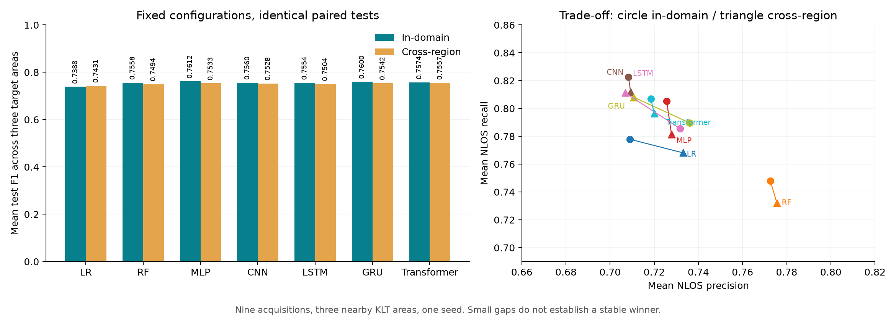

# KLT 同域与跨区域识别

九段可靠采集、三个日期，共2851历元、45228条 GPS/北斗观测。排除作者标注不可靠的 `1116_KLT3_649`。九段统一调用固定版 Fossett/RTKLIB 提取器，按时间与卫星ID对齐相机标签；C/N0缺测与因果历史处理一致，训练侧拟合填充/标准化。

## 配对协议

同域训练含目标区域的其他完整采集段；跨区域排除目标区域全部非测试采集。每对共用验证/测试、种子与配置。比例以6:2:2为目标，完整段不拆散。

| 目标测试区域 | 共同测试采集段 | 共同验证采集段 |
|---|---|---|
| KLT1 | `1109_KLT1_421` | `0610_KLT3_404`, `1116_KLT2_169` |
| KLT2 | `1109_KLT2_301`, `1116_KLT2_169` | `0610_KLT3_404`, `1116_KLT1_184` |
| KLT3 | `1109_KLT3_666` | `0610_KLT1_203`, `1109_KLT2_301` |

| 目标区域 | 同域 train/val/test 历元 | 同域比例 | 跨区域 train/val/test 历元 | 跨区域比例 |
|---|---|---|---|---|
| KLT1 | 1,857 / 573 / 421 | 65.1 / 20.1 / 14.8% | 1,470 / 573 / 421 | 59.7 / 23.3 / 17.1% |
| KLT2 | 1,793 / 588 / 470 | 62.9 / 20.6 / 16.5% | 1,290 / 588 / 470 | 54.9 / 25.0 / 20.0% |
| KLT3 | 1,681 / 504 / 666 | 59.0 / 17.7 / 23.4% | 1,277 / 504 / 666 | 52.2 / 20.6 / 27.2% |

跨区域同时改变训练量和日期分布，差值不是纯地理因果效应；部分同日采集相邻，旧测试记录已在开发中查看。模型/早停/阈值规则见[模型卡](../MODEL_CARD.md)与[固定计划](../../config/nlos_protocols.json)。

## 本次运行结果

以下为三个目标区域等权均值，逐区F1先计算后平均；测试排名不用于重新选模。

| 模型 | 同域 Precision | 同域 Recall | 同域 F1 | 跨区域 Precision | 跨区域 Recall | 跨区域 F1 | F1 变化 |
|---|---:|---:|---:|---:|---:|---:|---:|
| LR | 0.7089 | 0.7779 | 0.7388 | 0.7330 | 0.7681 | 0.7431 | +0.0043 |
| RF | 0.7725 | 0.7481 | 0.7558 | 0.7756 | 0.7320 | 0.7494 | -0.0064 |
| MLP | 0.7256 | 0.8051 | 0.7612 | 0.7278 | 0.7813 | 0.7533 | -0.0079 |
| CNN | 0.7083 | 0.8226 | 0.7560 | 0.7093 | 0.8119 | 0.7528 | -0.0032 |
| LSTM | 0.7317 | 0.7856 | 0.7554 | 0.7069 | 0.8112 | 0.7504 | -0.0051 |
| GRU | 0.7361 | 0.7896 | 0.7600 | 0.7107 | 0.8081 | 0.7542 | -0.0057 |
| Transformer | 0.7184 | 0.8069 | 0.7574 | 0.7200 | 0.7965 | 0.7557 | -0.0017 |
| C/N0 rule | 0.6355 | 0.6189 | 0.6270 | 0.6355 | 0.6189 | 0.6270 | +0.0000 |



平均验证 F1 选择同域 GRU、跨区域 Transformer；测试均值领先者分别为 MLP、Transformer。差距较小且仅单种子，不能认定稳定优势。共享测试段的固定 C/N0 规则必然得分相同，不能据此判断无域偏移。

标签计数以原始文件为准：`0610_KLT3_404` NLOS2461，比作者 README 多70，未人工改标签。汇总与来源指纹见[JSON](nlos_protocols_report.json)。

## 复现

```powershell
.\.venv\Scripts\python.exe scripts/fetch_nlos_data.py
.\.venv\Scripts\python.exe scripts/fetch_klt_extended.py
.\.venv\Scripts\python.exe tools/klt/prepare.py
.\.venv\Scripts\python.exe -m navdiag compare-nlos-protocols
```

先安装 [KLT 工具依赖](../../tools/klt/README.md)。计划、输入与实现先冻结；变更后用新目录。原始数据、模型和逐星预测不随仓库分发，详见[许可](../OPEN_SOURCE_REFERENCES.md)。
