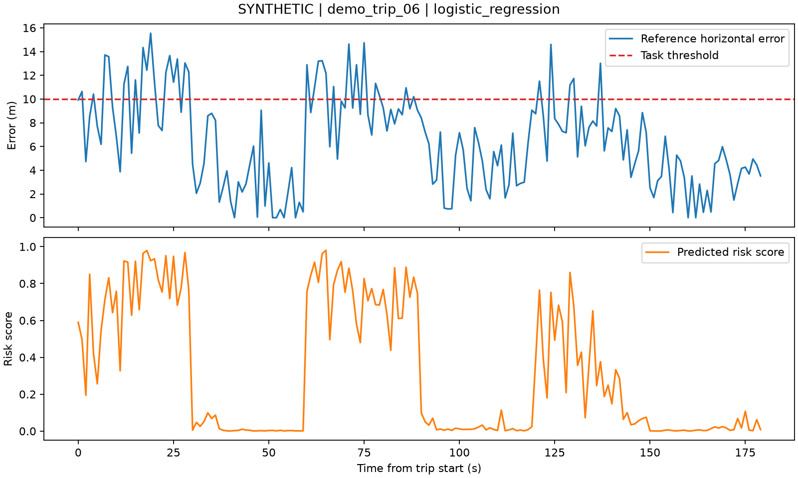

# v0.1 模拟教学实验

状态：本地完整演示和诊断命令运行成功；10 项测试通过；依赖检查通过。此记录来自模拟数据，不能推断真实 GNSS 定位能力。

## 可复现设置

- 日期：2026-10-10。
- Python：3.12.14；scikit-learn：1.9.1；依赖快照：`requirements-lock.txt`。
- 模拟数据：15 段行程，每段 180 个历元，共 2700 行。
- 随机种子：42。
- 任务：水平误差大于 10 米为正类。
- 按整段行程划分：9 段训练、3 段验证、3 段测试。
- 模型与分类阈值只用验证集选择，测试集只用来报告。
- 复现命令：`python -m navdiag demo`。

## 留出测试集结果

| 方法 | Precision | Recall | F1 |
| --- | ---: | ---: | ---: |
| 固定规则 | 0.768 | 0.897 | 0.827 |
| 逻辑回归 | 0.854 | 0.779 | 0.815 |
| 随机森林 | 0.841 | 0.815 | 0.828 |

验证集选出的模型是逻辑回归，虽然它在这次测试集上的 F1 不是最高。我们保留这个结果，因为不能在看过测试答案后重新挑选模型。这是本次实验最值得理解的评测原则。

完整指标、各段行程 ID、阈值与数据指纹由程序保存到 `artifacts/demo/report.json`。后续代码修改可能改变结果，重新运行时以新的报告为准。

图上半部分是人为生成的参考水平误差，下半部分是模型预测的风险评分。模型会漏报和误报；风险评分尚未经过真实数据概率校准。

## 下一步需要证明什么

真实数据的标签可靠性、未见路线与设备的泛化能力、坏定位的漏报率、模型推理耗时，以及质量预测接入滤波后是否改善最终位置误差。当前版本尚无这些结果。
