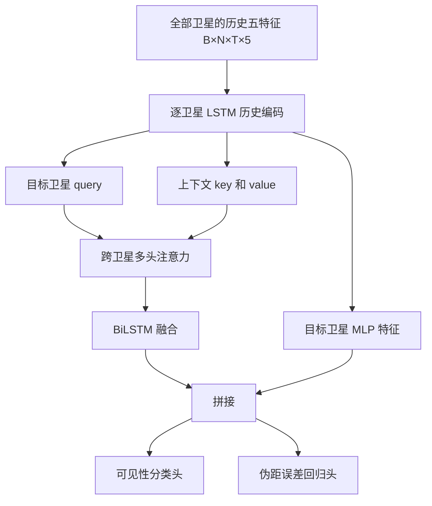

# NLOS 技术背景

基于 [Zhang 等 2023](https://arxiv.org/abs/2309.00480v2) 的方法解读；当前模型与论文的对应关系见[方法对照](../research/zhang2023_reproduction.md)。

## 直达、多径和 NLOS

LOS 表示卫星到天线的直达路径可用。多径表示还有经建筑、地面等反射的路径；即使直达路径存在，也可能受到多径干扰。NLOS 表示直达路径被阻挡，接收机可能仍收到反射/绕射信号。完全没有跟踪到信号是另一种情况，现有 KLT 表没有相应标签。

假设卫星直接到天线的距离为 r，经过楼面反射的路径比 r 长 30 m。传播时间多出约 100 ns，码伪距也可能带来约 30 m 额外偏差。定位器同时解算位置与接收机钟差，多颗卫星几何还会放大或相互影响误差，因此“伪距偏差 30 m”不等于“水平位置偏差 30 m”。

强反射信号的 C/N0 可能很高；弱 LOS 信号可能很低。所以一个 C/N0 阈值无法稳定分开所有 LOS/NLOS。高楼是可能的遮挡来源，但一条 NLOS 标签本身不能确定是楼、树还是车辆。

## 为什么是这些特征

| 特征 | 可以提供的线索 | 无法单独证明什么 |
| --- | --- | --- |
| 仰角 | 低仰角更易遇到周边障碍 | 高仰角必然 LOS |
| 方位角 | 同方向卫星可能共享遮挡环境 | 某个方向永远有楼 |
| C/N0 | 信号强弱与干扰状态 | 强信号必然可靠 |
| LS 伪距残差 | 观测与 GNSS 自身解算的一致性 | 残差小必然没有 NLOS |
| 历史残差 RSS | 一段时间的异常规模与持续性 | 异常一定由遮挡造成 |

最小二乘会调整位置和钟差去适应全部观测，因此坏观测也可能被解算“吸收”。残差来自当前 GNSS 解，不能当作独立真值。

论文 RSS 的定义是 `sqrt(sum(residual_t ** 2))`，单位仍为米。若三个历史残差为 3、4、0 m，RSS=5 m。它与残差 RMS、残差标准差、C/N0 标准差不同，也随窗口长度变化；不能互换命名。

论文伪距模型包含几何距离、接收机/卫星钟差、电离层、对流层、多径与噪声。预处理尽可能校正可建模项，让剩余信号更突出环境影响。实际校正不完美，不应把所有剩余误差都标成 NLOS。

## 标签怎样获得

鱼眼相机或 LiDAR 天空图能判断某个方位/仰角是否被物体遮住。它们主要用于训练标签，运行时的分类器可以只读取 GNSS 特征。论文 Aachen 标注还结合独立多传感器参考下的伪距残差阈值；当前 KLT 表是鱼眼相机标签，两者定义并不完全相同。

应始终区分：观测生成的输入特征、相机/地图产生的可见性标签、独立参考产生的伪距误差目标。用输入残差自己生成目标，再说模型识别了真实遮挡，会把一致性检测和独立遮挡识别混在一起。

## 论文网络为什么同时看时间和其他卫星

一颗卫星穿过建筑边缘时，信号/残差通常会随时间改变。LSTM 记录这种变化。若附近方向的几颗卫星也异常，其他卫星提供了环境上下文，注意力用目标卫星的 query 对所有上下文 key/value 分配权重。它是学习到的组合规则，权重本身不能作为物理原因证明。

论文分类与回归共同训练：分类头用 MSE，误差头用 L1。当前 Transformer 是单颗卫星 32 项历史分类、加权 BCE，无其他卫星上下文和误差真值头。两种结构有实质差别。

BiLSTM 会正向和反向遍历给定序列。若给定序列只包含截至当前时刻已有的历史，它不自动意味着读取了当前之后的新观测；若窗口包含未来时间，就有在线泄漏。复现时要先核实其序列轴、窗口末端和输出对应时间，而不是只检查网络名字。

## 怎样读 Precision、Recall 和 Accuracy

用 NLOS 作为正类。100 条实际 NLOS 中找到 70 条，Recall=70%。如果这 70 条正确报警之外还误报 30 条 LOS，Precision=70%。漏报反映风险，误报则可能让定位器错误排除好卫星、降低冗余和几何质量；两者都要看。

`F1 = 2*Precision*Recall/(Precision+Recall)`，对两者取调和平均。总体 Accuracy 还包含正确判为 LOS 的数量；如果 NLOS 很少，全判 LOS 也可能有高 Accuracy。当前实验按验证 F1 选模，测试同时报告 Precision 与 NLOS Recall。

论文 HK 的作者模型 NLOS F1=0.80，AC 同域 F1=0.46，HK→AC F1=0.48。它说明即使结构复杂，类别比例、接收机和环境差异仍影响成绩。不能拿别的数据上的高分直接给我们的 KLT 结果定目标。Düsseldorf 的 NLOS 预测比例没有真值分母，不是识别正确率。
